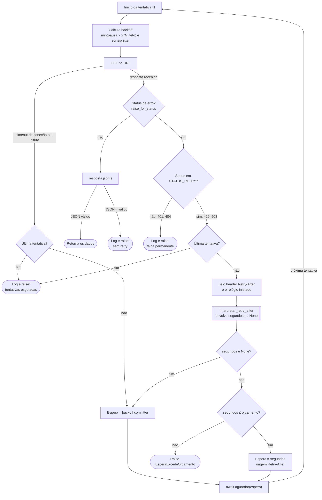
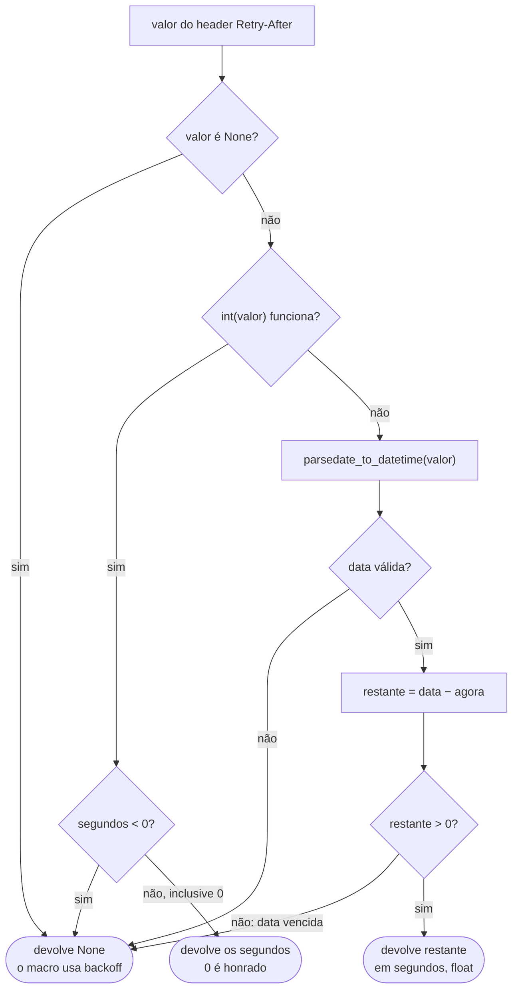

# Fluxo de decisão do cliente HTTP: quando repetir, quanto esperar e quando desistir.

# Caixas em âmbar = mudanças da unidade 10B (a implementar).

## Nível macro: a decisão de repetir (`extrair_com_retry`)

## Nível micro: como o header vira segundos (`interpretar_retry_after`)

## Decisões registradas

- `Retry-After: 0` em segundos é instrução explícita do servidor: honrar.
- Data vencida não é "tente agora": é valor velho ou relógio divergente. Devolve `None` e o macro usa backoff com jitter, que evita retries sincronizados.
- Orçamento: a espera pedida pelo `Retry-After` é limitada pelo parâmetro `orcamento_espera`, com padrão de 600 segundos. Pedido acima disso interrompe a extração com `EsperaExcedeOrcamento`. O backoff tem teto próprio (`espera_maxima`).
